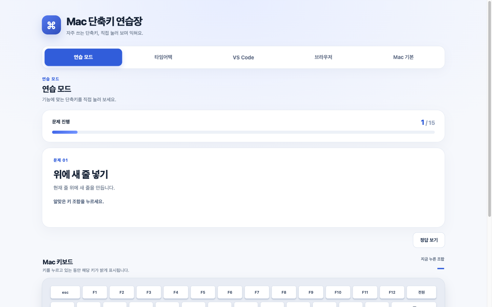
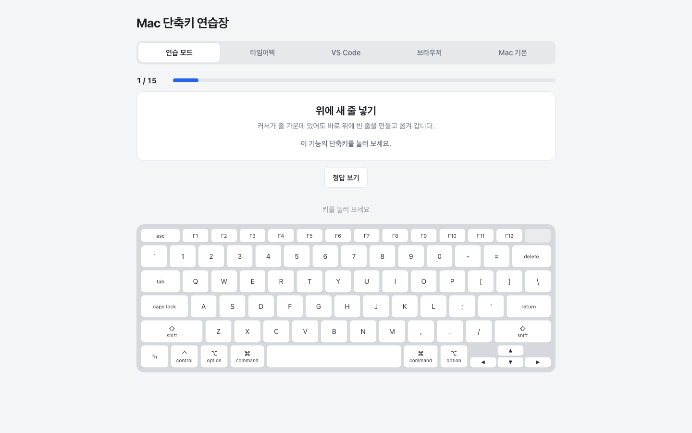

# 제작·검증 기록: 단축키 연습장 v1

## 두 AI 비교

- AI A (서비스·모델 이름): GPT-5.6 Sol — 결과 파일 `맥_단축키_연습장.html`
- AI B (서비스·모델 이름): Claude Opus 5.5 medium — 결과 파일 `mac-shortcut-practice.html`
- 동일한 기획서와 함께 전달한 요청: “이 기획서.md대로 HTML 파일 하나를 만들어 줘. CSS와 JavaScript까지 모두 이 파일 하나에 넣고, 다른 파일이나 로그인 없이 브라우저에서 바로 열리게 해 줘. 화면 문구는 한국어로 쓰고, 기획서에 없는 기능은 넣지 마.”
- 테스트 방법: Claude Code가 크롬 계열 브라우저에서 두 파일에 같은 키 입력과 같은 순서로 시험했습니다. 이후 사용자도 함께 그부분을 짚어 확인했습니다

| 테스트 내용 | GPT-5.6 Sol | Claude Opus 5.5 medium |
| --- | --- | --- |
| 노트북 크기 창에서 처음 열기 | 문제 카드는 보이지만 키보드 그림은 윗줄만 보이고, 아래로 내려야 전체가 보임 | 문제 카드와 키보드 그림 전체가 스크롤 없이 한 화면에 보임 |
| 연습 모드 15개를 모두 맞히기 | ‘첫 시도 정답 15 / 15개 (100%)’가 나옴 | ‘첫 시도 정답 15 / 15개 (100%)’가 나옴 |
| 타임어택 60초 동안 맞힘 16 · 틀림 4 · 건너뜀 4가 되게 누르기 | 결과가 같게 나옴. 60초에 끝나고, 끝난 뒤 키를 눌러도 점수가 그대로임 | 결과가 같게 나옴. 60초에 끝나고, 끝난 뒤 키를 눌러도 점수가 그대로임 |
| 타임어택에서 맞힌 뒤 다음 문제로 넘어가기 | 잠깐 멈춘 뒤 넘어가고, 그사이 누른 키는 세지 않음 | 바로 다음 문제가 나옴 |
| 창 폭을 조금씩 줄이기 | 노트북 화면을 반으로 나눈 것보다 조금 넓은 폭에서도 안내만 보임 | 그 폭에서는 연습 화면이 그대로 보이고, 더 좁히면 안내만 보임 |
| 연습 탭에서 ⌘ R, ⌘ L 누르기 | 틀린 키로 세지만 브라우저 동작은 막지 않음 | 틀린 키로 세고 브라우저 동작도 막음. 연습 탭에서는 ⌘ R로 새로고침되지 않음 |
| 결과 이미지 저장 | 모드와 날짜가 붙은 PNG가 내려받아지고 화면과 점수가 같음 | 모드와 날짜가 붙은 PNG가 내려받아지고 화면과 점수가 같음 |

**GPT-5.6 Sol 첫 화면 (선택하지 않은 결과)**

**Claude Opus 5.5 medium 첫 화면 (선택한 결과)**

- 선택한 결과물과 근거: Claude Opus 5.5 medium의 결과를 골랐습니다. 두 결과 모두 기능은 기획서대로 동작했지만, 키를 누르며 손과 화면을 같이 봐야 하는 페이지라 문제와 키보드가 한 화면에 보이는 이 결과가 목적에 맞습니다. GPT-5.6 Sol의 화면이 더 화려했지만 스크롤 없이 키보드를 볼 수 없었고, 타임어택도 Claude Opus 5.5 medium의 결과가 바로 다음 문제로 넘어갑니다.

선택한 파일: `단축키연습장_v1.html`

## 테스트 기록

| 번호 | 테스트 내용 | 예상 결과 | 실제 결과 |
| --- | --- | --- | --- |
| 1 | 연습 모드에서 15개를 모두 첫 시도에 맞게 누르기 | 15문제가 겹치지 않게 나오고, 결과 화면에 ‘첫 시도 정답 15 / 15개 (100%)’가 나옴 | 자동 키 입력으로는 예상한 대로 15문제가 겹치지 않았고 100%가 나옴. ‘다시 연습하기’를 누르니 1 / 15부터 다른 순서로 시작됨. 실제 Mac에서 직접 누르니 ⌘ ⇧ K와 ⇧ ⌥ ↓가 입력되지 않아 끝까지 하지 못함 (다음 미션에서 수정) |
| 2 (일부러 틀리기·정답 보기) | 첫 문제에서 Z를 한 번 잘못 누른 뒤 맞히고, 둘째 문제는 ‘정답 보기’를 누른 뒤 맞히고, 나머지는 모두 맞히기 | 잘못 누르면 ‘지금 누른 키: Z’가 나오고 넘어가지 않음. 정답 키에 금색 테두리가 생김. 결과는 첫 시도 정답 13 / 15개 (87%), 틀린 횟수 1번, 다시 연습할 단축키 2개 | 예상한 대로 나옴. 저장한 결과 이미지에도 같은 점수와 단축키 2개가 나옴 |
| 3 (창 폭을 바꿔 테스트) | 창 폭을 휴대폰 정도로 줄였다가 다시 넓히기 | 좁히면 탭과 연습 화면이 사라지고 안내만 보임. 넓히면 연습 화면이 돌아옴 | 예상한 대로 안내만 보였고, 넓히니 연습 화면이 돌아옴 |

실제 Mac 크롬에서 직접 눌러 추가로 확인한 완료 기준 (모두 문제없이 됐습니다):

- ⌘ P, ⌘ D 등을 눌러도 인쇄 창이나 북마크가 뜨지 않음
- 한글 입력 상태에서도 영문 입력 상태와 똑같이 판정됨
- ⌘를 누른 채 P만 뗐다가 ⌘를 떼도 불이 남지 않음

## 수정 기록

다음 미션 ‘테스트하며 고치고 사용자 피드백 반영하기’에서 작성합니다. 이번 미션에서는 고치지 않았습니다.

## 사용자 테스트

다음 미션에서 작성합니다.
