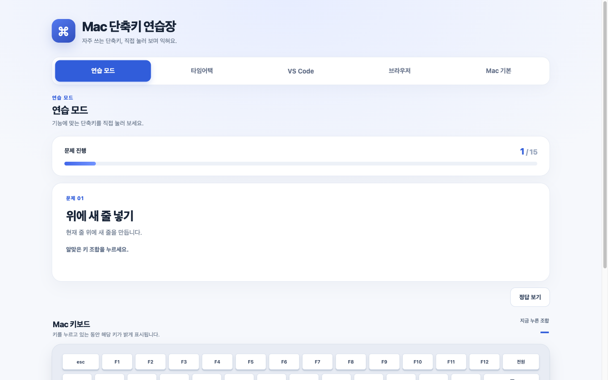
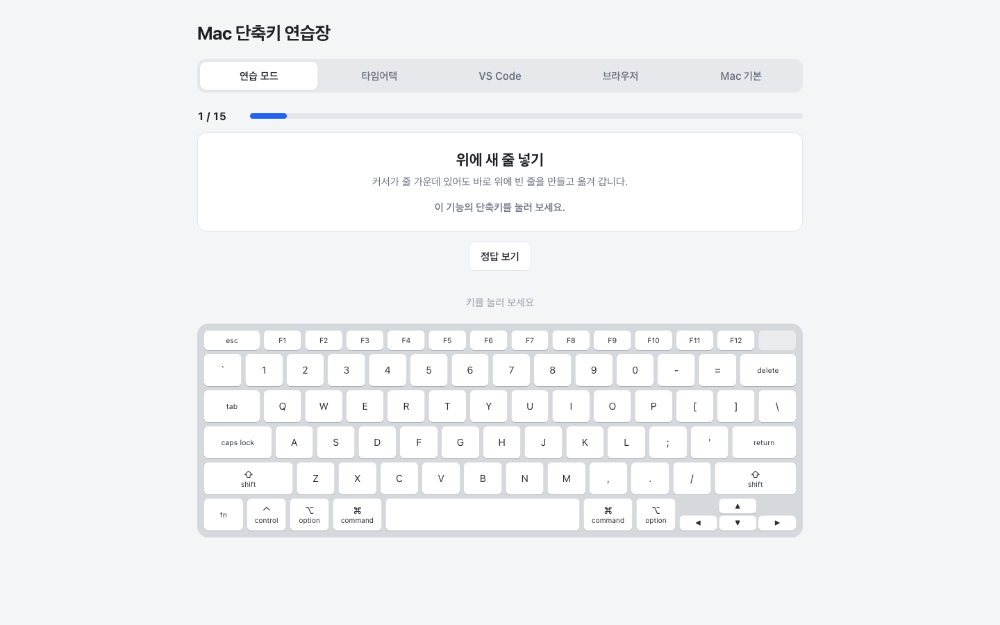

# 제작·검증 기록: Mac VS Code 단축키 연습장

## 두 AI 비교

- AI A (서비스·모델 이름): GPT-5.6 Sol — 결과 파일 `맥_단축키_연습장.html`
- AI B (서비스·모델 이름): Claude Opus 5.5 medium — 결과 파일 `mac-shortcut-practice.html`
- 동일한 기획서와 함께 전달한 요청: “이 기획서.md대로 HTML 파일 하나를 만들어 줘. CSS와 JavaScript까지 모두 이 파일 하나에 넣고, 다른 파일이나 로그인 없이 브라우저에서 바로 열리게 해 줘. 화면 문구는 한국어로 쓰고, 기획서에 없는 기능은 넣지 마.”
- 테스트 방법: Claude Code가 크롬 계열 브라우저에서 두 파일에 같은 키 입력과 같은 순서로 시험했습니다. 이후 사용자도 함께 그부분을 짚어 확인했습니다

| 테스트 내용 | GPT-5.6 Sol | Claude Opus 5.5 medium |
| --- | --- | --- |
| 노트북 크기 창에서 처음 열기 | 문제 카드는 보이지만 키보드 그림은 윗줄만 보이고, 아래로 내려야 전체가 보임 | 문제 카드와 키보드 그림 전체가 스크롤 없이 한 화면에 보임 |
| 연습 모드 15개를 모두 맞히기 | ‘첫 시도 정답 15 / 15개 (100%)’가 나옴 | ‘첫 시도 정답 15 / 15개 (100%)’가 나옴 |
| 타임어택 60초 동안 맞힘 16 · 틀림 4 · 건너뜀 4가 되게 누르기 | 결과가 같게 나옴. 60초에 끝나고, 끝난 뒤 키를 눌러도 점수가 그대로임 | 결과가 같게 나옴. 60초에 끝나고, 끝난 뒤 키를 눌러도 점수가 그대로임 |
| 타임어택에서 맞힌 뒤 다음 문제로 넘어가기 | 잠깐 멈춘 뒤 넘어가고, 그사이 누른 키는 세지 않음 | 바로 다음 문제가 나옴 |
| 창 폭을 조금씩 줄이기 | 노트북 화면을 반으로 나눈 것보다 조금 넓은 폭에서도 안내만 보임 | 그 폭에서는 연습 화면이 그대로 보이고, 더 좁히면 안내만 보임 |
| 연습 탭에서 ⌘ R, ⌘ L 누르기 | 틀린 키로 세지만 브라우저 동작은 막지 않음 | 틀린 키로 세고 브라우저 동작도 막음. 연습 탭에서는 ⌘ R로 새로고침되지 않음 |
| 결과 이미지 저장 | 모드와 날짜가 붙은 PNG가 내려받아지고 화면과 점수가 같음 | 모드와 날짜가 붙은 PNG가 내려받아지고 화면과 점수가 같음 |

**GPT-5.6 Sol 첫 화면 (선택하지 않은 결과)**

**Claude Opus 5.5 medium 첫 화면 (선택한 결과)**

- 선택한 결과물과 근거: Claude Opus 5.5 medium의 결과를 골랐습니다. 두 결과 모두 기능은 기획서대로 동작했지만, 키를 누르며 손과 화면을 같이 봐야 하는 페이지라 문제와 키보드가 한 화면에 보이는 이 결과가 목적에 맞습니다. GPT-5.6 Sol의 화면이 더 화려했지만 스크롤 없이 키보드를 볼 수 없었고, 타임어택도 Claude Opus 5.5 medium의 결과가 바로 다음 문제로 넘어갑니다.

선택한 파일: `단축키연습장_v1.html` (이후 수정 버전은 v2부터 v9까지 저장함)

## 테스트 기록

| 번호 | 테스트 내용 | 예상 결과 | 실제 결과 |
| --- | --- | --- | --- |
| 1 | 연습 모드에서 15개를 모두 첫 시도에 맞게 누르기 | 15문제가 겹치지 않게 나오고, 결과 화면에 ‘첫 시도 정답 15 / 15개 (100%)’가 나옴 | Claude Code의 자동 키 입력으로는 예상한 대로 15문제가 겹치지 않았고 100%가 나옴. ‘다시 연습하기’를 누르니 1 / 15부터 다른 순서로 시작됨. **실제 Mac에서는 테스트 4 때문에 끝까지 하지 못함** |
| 2 (일부러 틀리기·정답 보기) | 첫 문제에서 Z를 한 번 잘못 누른 뒤 맞히고, 둘째 문제는 ‘정답 보기’를 누른 뒤 맞히고, 나머지는 모두 맞히기 | 잘못 누르면 ‘지금 누른 키: Z’가 나오고 넘어가지 않음. 정답 키에 금색 테두리가 생김. 결과는 첫 시도 정답 13 / 15개 (87%), 틀린 횟수 1번, 다시 연습할 단축키 2개 | 예상한 대로 나옴. 저장한 결과 이미지에도 같은 점수와 단축키 2개가 나옴 |
| 3 (창 폭을 바꿔 테스트) | 창 폭을 휴대폰 정도로 줄였다가 다시 넓히기 | 좁히면 탭과 연습 화면이 사라지고 안내만 보임. 넓히면 연습 화면이 돌아옴 | 예상한 대로 안내만 보였고, 넓히니 연습 화면이 돌아옴 |
| 4 (실제 Mac 키보드로 15개 누르기) | 실제 Mac 크롬에서 연습 모드 15문제를 직접 누르기 | 모든 조합이 눌리고 끝까지 풀 수 있음 | ⌘ ⇧ K를 누르면 그림과 글자에 ⌘ ⇧만 나오고 K가 나오지 않음. ⇧ ⌥ ↓도 입력되지 않음. 넘어갈 방법이 없어 연습 모드를 끝내지 못함. 수정 기록 1로 건너뛰기를 추가했고, 수정 기록 4로 두 단축키를 뺌 |
| 5 (누르는 순서 바꾸기) | 같은 조합을 키 순서만 바꿔 누르기 | 함께 눌렸으면 순서와 상관없이 맞음 | 조합이 맞아도 순서가 다르면 틀렸다고 나옴. 수정 기록 2로 고침 |
| 6 (페이지 이름 확인) | 첫 화면 제목을 보고 무엇을 연습하는 페이지인지 확인하기 | VS Code 단축키 연습장임을 알 수 있음 | 제목이 ‘Mac 단축키 연습장’이라 Mac 단축키를 알려 주는 페이지처럼 보임. 수정 기록 3으로 고침 |
| 7 (브라우저 단축키) | 연습 탭에서 ⌘ R, ⌘ L 누르기 | 페이지가 키를 받아 새로고침이나 주소창 이동이 되지 않음 | 예상한 대로 새로고침, 주소창 이동이 되지 않고 키보드 그림에만 켜짐 |
| 8 (타임어택 중 탭 이동) | 타임어택 중 다른 탭으로 옮기기 | 시간이 계속 줄어듦 | 예상한 대로 시간이 멈추지 않음. 탭을 옮겨 답을 보고 와도 시간이 줄어드니 고치지 않고 기획서에 적음 |

테스트 1, 2, 3은 이전 미션에서 Claude Code의 자동 키 입력으로 시험했고, 테스트 4부터 8까지는 내가 실제 Mac 크롬에서 직접 눌렀다. 자동 입력에서는 나타나지 않았던 테스트 4의 문제를 직접 눌러 보고 찾았다.

실제 Mac 크롬에서 직접 눌러 추가로 확인한 완료 기준 (모두 문제없이 됐습니다):

- ⌘ P, ⌘ D 등을 눌러도 인쇄 창이나 북마크가 뜨지 않음
- 한글 입력 상태에서도 영문 입력 상태와 똑같이 판정됨
- ⌘를 누른 채 P만 뗐다가 ⌘를 떼도 불이 남지 않음

## 수정 기록

수정은 Claude Code / Claude Opus 5.5에게 요청했다. 버전을 나눌 때마다 파일 전체를 저장했고, 수정 후 15문제를 건너뛰기·오답·정답 보기를 섞어 끝까지 풀어 이전 기능도 다시 확인했다.

### 수정 기록 1 (`단축키연습장_v2.html`)

- 발견한 문제: 실제 Mac에서 연습 모드 15문제를 누르면(테스트 내용) 모두 입력되어 끝까지 풀 수 있을 줄 알았는데(예상 결과), ⌘ ⇧ K를 누르면 ⌘ ⇧만 켜지고 K는 나오지 않았다. 개발자 도구에서 키 입력을 찍어 보니 ⌘ ⇧ K는 `MetaLeft`, `ShiftLeft`까지만, ⇧ ⌥ ↓는 `AltLeft`, `ShiftLeft`까지만 찍혔다. 건너뛸 버튼도 없어 그 문제에서 멈췄다(실제 결과). ⇧ ⌥ ↓는 내가 쓰는 Raycast 입력이 같이 들어가는 것으로 보이지만 원인을 확인하지는 않았다.
- AI에게 전달한 요청: “커맨드 쉬프트 케이만 안 눌려. 세 키를 누르면 커맨드 쉬프트만 떠. 연습모드 건너뛰기도 없다. 이건 이번 미션에서 해야 될 듯.” (키 입력을 찍은 콘솔 결과를 함께 전달)
- 수정 후 테스트 결과: 연습 모드에 ‘건너뛰기’와 안내 문구가 생겼다. 2문제 건너뛰기, 1문제 오답 후 정답, 1문제 정답 보기로 끝까지 풀어 ‘첫 시도 정답 11 / 15개 (73%), 틀린 횟수 1번 · 건너뜀 2개’와 다시 연습할 단축키 4개가 나왔다. 처음에는 안내 문구 때문에 키보드가 아래로 밀려 한 화면에 안 들어와서 여백을 줄였고, 다시 v1처럼 한 화면에 들어오는 것을 확인했다. ⌘ ⇧ K 자체는 여전히 페이지에 입력되지 않는다. 실제 Mac에서도 건너뛰기를 누르니 다음 문제로 넘어갔고, 결과 화면에 건너뛴 수가 나왔다.
- 수정 이유: 내 컴퓨터에서 입력되지 않는 키가 하나만 있어도 그 문제에서 멈춰 결과 화면과 결과 저장까지 갈 수 없다. 페이지가 받지 못하는 입력은 맞힐 방법이 없으니, 다른 사용자도 같은 일을 겪을 때 계속할 수 있어야 한다.

### 수정 기록 2 (`단축키연습장_v3.html`)

- 발견한 문제: 같은 조합을 키 순서만 바꿔 누르면(테스트 내용) 맞다고 나올 줄 알았는데(예상 결과) 틀렸다고 나왔다(실제 결과). 자동 입력으로 다시 해 보니 F → ⌥ → ⌘은 ‘지금 누른 키: F’, ⌘ → P → ⇧은 ‘지금 누른 키: ⌘ P’로 틀렸고, ⌥ → ⇧ → ↓처럼 ⌘ ⌥ ⌃ ⇧끼리만 순서를 바꾼 것은 맞았다.
- AI에게 전달한 요청: “조합이 맞아도 들어가는 순서가 다르면 틀렸다고 된다.”
- 수정 후 테스트 결과: 자동 입력에서 F → ⇧ → ⌥, ⌘ → Enter → ⇧, ⇧ → ⌘ → P 모두 ‘맞았어요!’가 나왔다. Z는 그대로 ‘지금 누른 키: Z’로 틀렸고 다음 문제로 넘어가지 않았다. 연습 모드 끝까지 풀기와 타임어택 점수도 같게 나왔다. 실제 Mac에서도 전에 틀렸던 순서로 누르니 맞다고 나왔다.
- 수정 이유: 키를 정확히 눌렀는데 손가락이 닿은 순서 때문에 틀렸다고 나오면, 사용자는 단축키를 잘못 외웠다고 생각하게 되고 첫 시도 정답과 틀린 횟수도 실제 실력과 달라진다.

### 수정 기록 3 (`단축키연습장_v4.html`)

- 발견한 문제: 첫 화면 제목을 보고 무엇을 연습하는 페이지인지 확인하면(테스트 내용) VS Code 단축키 연습장임을 알 수 있을 줄 알았는데(예상 결과), 제목이 ‘Mac 단축키 연습장’이라 Mac 단축키를 알려 주는 페이지처럼 보였다(실제 결과). 연습 문제 15개는 모두 VS Code 단축키다.
- AI에게 전달한 요청: “우리 지금 Mac의 VS Code 단축키 연습장이지 맥 단축키 설명장이 아니잖아.”
- 수정 후 테스트 결과: 화면 제목, 브라우저 탭 제목, 저장한 결과 이미지의 제목이 ‘Mac VS Code 단축키 연습장’으로 바뀌었다. 연습 모드 끝까지 풀기, 타임어택 60초 점수와 끝난 뒤 점수 고정, 결과 이미지 저장, 좁은 창 안내도 이전처럼 동작했다.
- 수정 이유: 제목만 보면 Mac 기본 단축키를 배우는 곳으로 알고 들어와, 문제를 보고 나서야 VS Code 연습이라는 것을 알게 된다.

### 수정 기록 4 (`단축키연습장_v5.html`)
- 발견한 문제: 실제 Mac에서 연습 단축키 15개를 모두 맞힐 수 있는지 확인하면(테스트 내용) 모두 입력될 줄 알았는데(예상 결과), ⌘ ⇧ K와 ⇧ ⌥ ↓는 입력되지 않아 맞힐 수 없었고, 건너뛰기는 넘어가게만 해 줄 뿐 그 문제를 풀 수는 없었다(실제 결과).
- AI에게 전달한 요청: “그 안 눌리는 거 다 빼버리자. 명령어 15개 다른 걸로 맞출 수 있잖아.”
- 수정 후 테스트 결과: 두 단축키를 빼고 VS Code 공식 Mac 단축키 PDF에 있는 ⌃ G(원하는 줄로 이동하기), `⌘ \`(편집기 나누기)를 넣어 15개를 맞췄다. 나머지 13개도 PDF에 있는 것을 확인했다. 실제 Mac에서 15문제를 직접 눌러 보니 문제없이 끝까지 할 수 있었다.
- 수정 이유: 내 Mac에서 입력되지 않는 단축키가 문제로 나오면 건너뛰는 수밖에 없어 그 문제는 연습할 수 없고, 첫 시도 정답도 100%가 나올 수 없다.

## 사용자 테스트
- 테스트 참여자와 요청한 작업: 코디세이 동료 1명이 직접 했다. 그전에 동료 역할의 AI 에이전트 1명(Claude Code에서 새로 띄운 에이전트, 이전 대화 내용을 모름)도 `단축키연습장_v5.html`을 자동 키 입력으로 먼저 해 보았다. 둘 다 사용법은 설명하지 않고 “연습 모드를 끝까지 해 보고 결과 이미지를 저장해 보세요. 그다음 타임어택도 한 번 해 보세요.”라고만 요청했다.
- 사용자의 행동과 질문: 동료는 화면을 처음 보자마자 “타자 연습이야?”라고 했다가 상단의 제목을 보고 진행했다. 초반에는 아는 단축키가 많지 않아 건너뛰기를 많이 눌렀다. 타임어택은 생소한 문제라 처음에는 2, 3문제밖에 풀지 못했지만, 연습 모드를 5번 한 뒤에는 시간 안에 8문제에서 10문제까지 늘었다. 질문은 “이 결과가 어디에 저장되었는지”였다. 에이전트는 15문제를 끝까지 풀고 이미지를 저장했으며, “저장이 실제로 됐는지, 어디에 저장됐는지”, “틀린 횟수는 1번인데 다시 연습할 단축키가 왜 2개인지”, “타임어택 문제가 고르게 나오는지”를 물었다.
- 받은 피드백: 에이전트의 피드백은 (1) 타임어택에서 제목은 ‘줄을 위로 옮기기’인데 그 아래에 ‘맞았어요! ⌘ ⇧ Enter’가 함께 보여, 지금 문제의 답처럼 읽힌다. (2) ‘결과 이미지 저장’을 눌러도 화면에 저장 완료 안내가 없다. (3) 정답을 본 문제가 결과 문구에 나오지 않아 숫자가 맞지 않아 보인다. 직접 테스트에서 나온 피드백은 “정답이 0%로 뜨는데 왜인지 확인이 안 됐다. 정답 확인으로 한 것도 따로 개수를 확인하게 해 달라”와 (4) 탭이 한 줄에 다 있어서 오해의 소지가 있다는 것이다.
- 반영 내용과 결과: (1)은 `단축키연습장_v6.html`에서 문구를 ‘맞았어요! 방금 문제의 답: ⌘ ⇧ Enter’로 바꿨고, 다시 시험해 새 문제와 직전 문제의 답이 구분되어 나오는 것을 확인했다. (3)은 `단축키연습장_v7.html`에서 결과 화면과 결과 이미지에 ‘정답 본 문제’ 수를 넣었고, 15문제 모두 정답을 보고 풀면 ‘첫 시도 정답 0 / 15개 (0%), 틀린 횟수 0번 · 정답 본 문제 15개 · 건너뜀 0개’가 나와 0%인 이유를 알 수 있는 것을 확인했다. (4)는 `단축키연습장_v8.html`에서 탭을 ‘키를 눌러 연습하기’와 ‘단축키 표 보기’ 두 묶음으로 나눴고, 다섯 탭이 모두 전환되는 것과 키보드가 이전처럼 한 화면에 들어오는 것을 확인했다. 15문제 완주, 건너뛰기, 타임어택도 그대로 동작했다. (2)는 동료와 에이전트 모두 어디에 저장됐는지 물어서 `단축키연습장_v9.html`에 반영했다. 저장하면 결과 화면에 ‘이미지를 저장했어요. 크롬 다운로드 목록이나 다운로드 폴더에서 (파일 이름) 파일을 확인해 주세요.’가 나오는 것을 연습 모드와 타임어택에서 확인했고, 다시 연습하기와 타임어택 점수도 그대로 동작했다.
